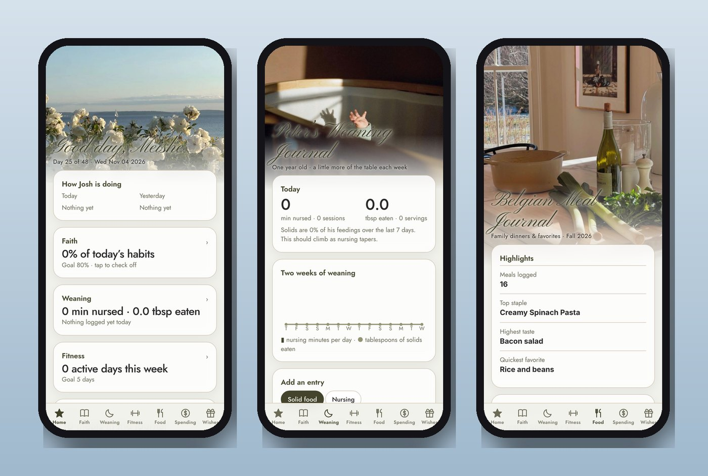
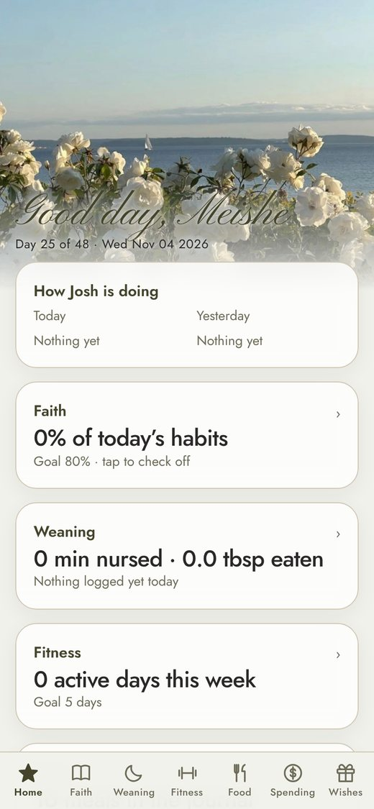
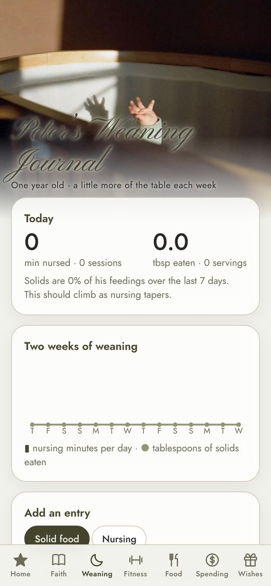
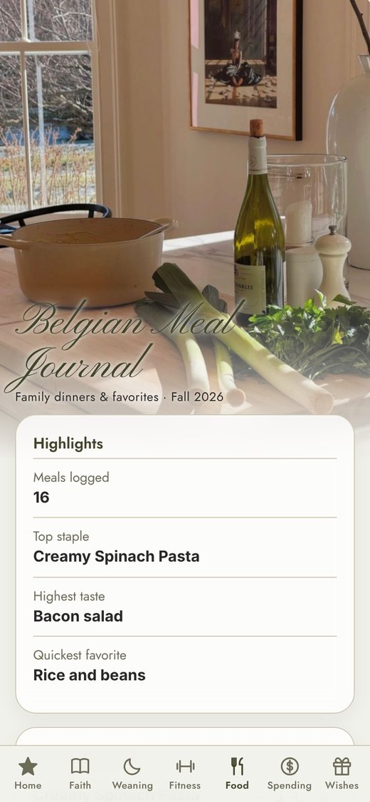

<h1 align="center">Habits: Meishe (Garden Book)</h1>

<em>A warm, quiet journal for faith, family, meals and more.</em>

<a href="https://joshp523.github.io/Habit-tracker-app-Meishe/"><b>▶ Open the app</b></a>

Meishe's Garden Book is a gentle habit journal in a soft garden palette, with its own pages for faith, the baby's first foods, movement, Belgian meals and the household budget.

## The pages

- **Home:** today's habits at a glance, the weekly streak, and *How Josh is doing*, a peek at his day.
- **Faith:** a daily habit checklist with weekly progress.
- **Weaning:** Peter's first-foods journal: what he's tried, allergens introduced, and variety over two weeks.
- **Fitness:** log a move and celebrate every step.
- **Food:** a Belgian meal journal and a box of family favorites.
- **Spending:** a weekly budget, split into Unavoidable, Optional and Frivolous.
- **Wishes:** shared wish lists with Josh.

<table><tr><td align="center" valign="top"> Home</td><td align="center" valign="top"> Weaning journal</td><td align="center" valign="top"> Belgian meal journal</td></tr></table>
## Why it's worth a look

- **Cool:** It's beautiful: painted backdrops and script lettering make checking in feel calm, not like a chore.
- **Innovative:** Two people, two very different apps, one shared household. Meishe and Josh each see a little of the other's day.
- **Impressive:** A baby weaning tracker, meal journal, budget and wish list in one, made for one person's real life.
- **Useful:** Everything a busy young mother wants to keep track of, on the phone she already has in her hand.

---

### On your phone
Open the link in Safari (iPhone/iPad) or Chrome (Android), then choose **Share → Add to Home Screen**. It gets its own icon and opens full-screen, just like an app from the store.

### More apps by Josh Riley
[The Riley Rag](https://joshp523.github.io/RileyRag/) · [QuipRash](https://joshp523.github.io/Quip-game-app/) · [Word Games](https://joshp523.github.io/Word-Games/) · [Russian Verbs](https://joshp523.github.io/russian/) · [Riley Rangers](https://joshp523.github.io/Rangers-app/) · [Habits: Josh](https://joshp523.github.io/daily-discipline/) · [Habits: Grandma](https://joshp523.github.io/wendys-app/) · [Writing](https://joshp523.github.io/writing-app/)

Built by Josh Riley. Setup notes for whoever maintains it are in [SETUP.md](SETUP.md).
